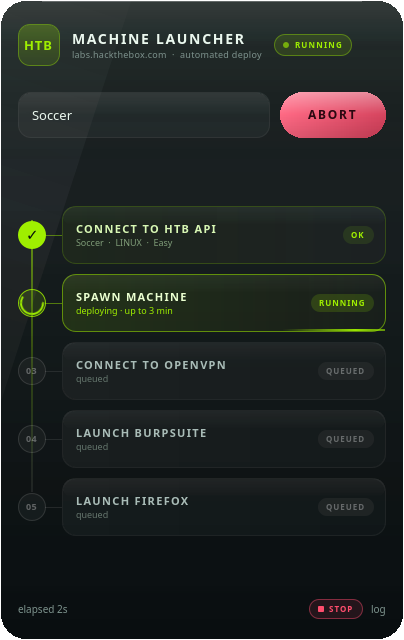
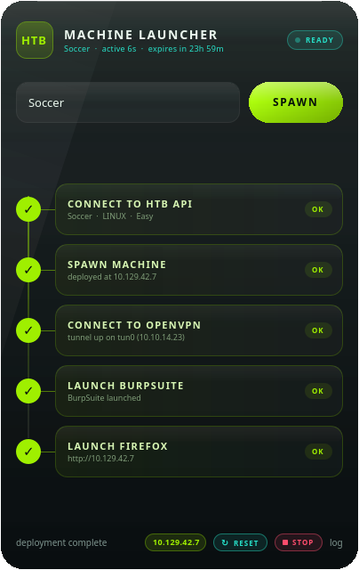
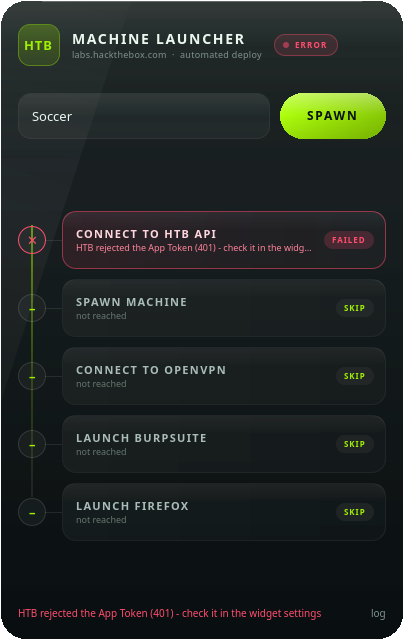
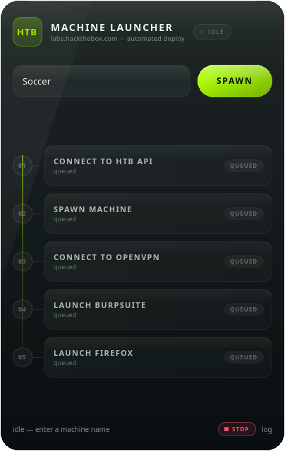

# HTB Machine Launcher — KDE Plasma 6 widget

A liquid-glass, neon-on-dark desktop widget for CachyOS / KDE Plasma 6 that takes
a machine name and walks a ladder:

```
01  CONNECT TO HTB API     → authenticate, resolve the machine
02  SPAWN MACHINE          → deploy it, wait for the IP
03  CONNECT TO OPENVPN     → bring the tunnel up (skipped if already up)
04  LAUNCH BURPSUITE       → start Burp (skipped if not installed)
05  LAUNCH FIREFOX         → open http://<machine-ip>
```

Each rung is a glass box on a neon rail: **queued → spinning → ✓ / ✕**, with the
machine IP shown in the footer when the run is complete.

| deploying | ready | error | after STOP |
|---|---|---|---|
|  |  |  |  |

Settings page: `docs/preview-settings.png`

---

## Requirements

| Thing | Why |
|---|---|
| KDE Plasma **6** (tested on 6.8) | plasmoid API 6.0 |
| `python3` (stdlib only) | backend — no pip packages needed |
| `openvpn` + `pkexec` | VPN rung (or switch it to `sudo -n` / off) |
| `burpsuite`, `firefox` | optional; missing tools degrade to a warning |

BurpSuite is auto-detected, so a jar-based install works without configuration:
the explicit setting, then `burpsuite`/`burpsuite_pro`/`burp` on `PATH`, then the
`Exec=` line of any `*burp*.desktop` entry (e.g. a Pro launcher script in
`~/Downloads/BurpSuite_pro`), then known launcher/jar locations, then Flatpak.

## Install

```bash
./install.sh
```

Then:

1. Right-click the desktop → **Enter Edit Mode** → **Add Widgets…**
2. Search **HTB Machine Launcher**, drag it onto the desktop
3. Right-click the widget → **Configure → Launcher** and fill in:
   * **App Token** — from <https://app.hackthebox.com/profile/settings> → *App Tokens*
   * **VPN profile** — your `.ovpn` file (e.g. `~/htb/lab.ovpn`)
   * **Connect using** — `pkexec` (graphical password prompt), `sudo -n`
     (passwordless), or `none` (treat the tunnel as already up)
   * **BurpSuite / Firefox commands** — anything on your `PATH`, args allowed
     (`burpsuite --project-temp-dir /tmp`), or an absolute path

If the widget does not show up in the picker:

```bash
systemctl --user restart plasma-plasmashell.service
```

## Use

Type a name (`Soccer`, `DevOops`, …) and hit **Enter** or **SPAWN**.
While a run is active the button becomes **ABORT** and kills the current rung.

The header subtitle becomes a live machine read-out once something is up:

```
MACHINE LAUNCHER
Cap · active 16h 56m · expires in 7h 04m
```

`active` is derived from HTB's `expires_at` minus the 24 h box lifetime, and
`expires in` is the authoritative countdown — both tick every second. The state
is re-synced from `GET /machine/active` when the widget loads, so a machine
spawned earlier (or from the website) is picked up automatically, and an idle
ladder is shown as `ACTIVE` rather than pretending a run happened.

**RESET** (`↻`) restarts the active machine via `POST /machine/reset`, waits for
it to come back, and re-reads `expires_at`, so the timer snaps back to `active 0s
· expires in 23h 59m`. If the reset route is unavailable it falls back to
terminate + spawn. Nothing running → `no machine is running` (not an error).

**STOP** (the red chip in the footer) terminates whatever machine is active on
your account — including one spawned from the website — and then resets the
widget: ladder back to queued, IP cleared, timer cleared, status `IDLE`. It works
whether a run is in progress or the ladder is already complete:

* nothing active → `no machine is running` (not an error)
* active → `POST /machine/terminate`, then it polls until HTB reports the
  machine gone (up to 45 s) and shows `Cap terminated`
* the stop is independent of the ladder, so it also cleans up after a failed run

The footer `log` link opens a live log drawer; backend errors (rejected token,
VPN profile missing, HTB queue timeout) are shown both there and in the footer.

## How it works

Plasma's `executable` data engine delivers a process' stdout **only when the
process exits**, so streaming one long script would freeze the ladder. Instead
QML drives one short-lived process per rung:

```bash
python3 contents/scripts/htb_spawn.py --phase api     --job '<url-encoded JSON>'
python3 contents/scripts/htb_spawn.py --phase spawn   --job '…'
python3 contents/scripts/htb_spawn.py --phase vpn     --job '…'
python3 contents/scripts/htb_spawn.py --phase burp    --job '…'
python3 contents/scripts/htb_spawn.py --phase firefox --job '…'
```

Every phase prints one JSON line and exits non-zero on failure:

```json
{"stage": "spawn", "state": "done", "detail": "deployed at 10.129.42.7", "ip": "10.129.42.7"}
```

The job (machine name, machine id, VPN settings, tool commands) travels as a
single percent-encoded argument, and the machine name is validated before it is
used. **The App Token is deliberately not part of the job**: the backend reads it
straight from Plasma's applet config, so it never appears in a command line or in
`ps` output.

VM lifecycle endpoints (verified live — HTB moved these to `/vm/*`, the old
`POST /machine/active`, `/machine/terminate` and `/machine/reset` now return
`405 The POST method is not supported...` / `404 The route ... could not be found`):

| action | endpoint |
|---|---|
| spawn | `POST /api/v4/vm/spawn` `{"machine_id": N}` |
| terminate | `POST /api/v4/vm/terminate` |
| restart / reset timer | `POST /api/v4/vm/reset` `{"machine_id": N}` |

The backend still falls back to the legacy routes, and the test suite's mock
returns the same 405/404s the real API does, so a silent regression is impossible.

Machine lookup order (verified against the live v4 API):

1. `GET /machine/profile/<name>` — canonical, **case-insensitive**, works for
   active *and* retired machines (`cap` → `Cap`, id 351)
2. `GET /search/fetch?query=` — fallback if the profile route fails
3. crawl `/machine/list` + `/machine/list/retired` — older API revisions only;
   on today's API both routes return `404 The route … could not be found`, so
   they are no longer the primary path (this is what made every name look
   "not found" in 1.0.0)

A name that resolves ambiguously (`ca` → `Cap`, `Capital`) is refused with the
candidate list, and an unknown name reports the 404 instead of a bare "not found".

Notes:

* `spawn` reuses an already-active machine instead of re-deploying it, and
  terminates a *different* active machine first (configurable).
* `vpn` skips itself when a `tun*/tap*/wg*/ppp*` interface already has an
  address; otherwise it launches OpenVPN detached and waits for the interface.
  OpenVPN's output goes to `~/.cache/htb-launcher/openvpn.log`.
* `burp` / `firefox` are launched detached, in a new session, so they survive
  the widget. Firefox opens `http://<ip>` when the toggle is on. The BurpSuite
  stage reports *what* it launched (e.g. `launched burpsuite_pro_launcher`), and
  a fish/bash alias called `burpsuite` does not count — aliases are not
  executables, which is why the desktop entry is used instead.
* Abort kills the rung that is currently running, not the tools already opened.

## CLI (handy for debugging)

```bash
cd plasmoid/org.htb.machinelauncher/contents/scripts

# one rung
python3 htb_spawn.py --phase api --job-json '{"machine":"Soccer","token":"<TOKEN>"}'

# everything at once
python3 htb_spawn.py --all --job-json '{"machine":"Soccer","token":"<TOKEN>","vpn_mode":"none"}'

# no network at all: fake the ladder
python3 htb_spawn.py --demo
```

Set `HTB_LAUNCHER_API` to point the backend at another base URL (used by the
tests).

The token is resolved in this order: `--token` / `token` in the job (CLI only) →
`HTB_TOKEN` in the environment → the plasmoid config. The widget itself only uses
the last one.

Explain any lookup (prints counts/statuses, never the token):

```bash
python3 htb_spawn.py --diagnose --job-json '{"machine":"cap","token":"<TOKEN>"}'
```

## Tests / preview

```bash
python3 dev/test_backend.py                 # mock HTB API, 7 end-to-end checks
./dev/check_plasmoid.sh                     # load the applet in a real Plasma context
QT_QPA_PLATFORM=offscreen qml6 dev/shot.qml # render snapshots to /tmp/opencode
qml6 dev/preview.qml                        # live window (demo mode, no network)
```

`dev/check_plasmoid.sh` runs the applet through `plasmawindowed`, which creates a
real `Plasma::Applet` — that is the only way to catch Plasma-specific rules such
as *"the root item of <plugin> must be of type PlasmoidItem"*.

Package layout gotchas (both bit this project once):

* the root of `contents/ui/main.qml` **must** be a `PlasmoidItem`
* `ConfigCategory.source` in `contents/config/config.qml` is resolved relative to
  **`contents/ui/`** — so the page lives at `contents/ui/config/ConfigGeneral.qml`
  and is referenced as `config/ConfigGeneral.qml`

`dev/preview.qml` and `dev/shot.qml` load `contents/ui/Widget.qml` (the visual
layer) outside plasmashell; the widget falls back to a stub config there so it
can be developed standalone. `contents/ui/main.qml` is a thin plasmoid shell
that adds `Plasmoid.backgroundHints: NoBackground` next to it.

## Uninstall

```bash
kpackagetool6 --type Plasma/Applet --remove org.htb.machinelauncher
```

> Note: an older `com.local.htblauncher` plasmoid may still be installed from a
> previous attempt. This project installs side by side as `org.htb.machinelauncher`
> and does not touch it.

## Design notes

Plasmoids cannot sample the wallpaper behind them, so the "liquid glass" is
built from layered translucency: a frosted gradient body, a neon rim, drifting
blurred light blobs, a specular sheen and a diagonal reflection. Glow is done
with `MultiEffect` used as a layer effect. Palette: HTB green `#9fef00` on
`#071b12`-ish glass, aqua `#26e0c8` for "ready", red `#ff4d6d` for failures.

## Security & privacy

* **Where the token lives:** Plasma stores it in
  `~/.config/plasma-org.kde.plasma.desktop-appletsrc`, group
  `[Containments][N][Applets][M][Configuration][General]` → `appToken`. That file
  is plain text and world-readable by default on many distros (`-rw-r--r--`), so
  treat your home directory permissions as the security boundary — or `chmod 600`
  the file yourself. KWallet support is on the roadmap.
* **Never in `ps`:** the token is not passed as an argument. The backend opens the
  config file and reads it there; every command line only carries the machine
  name, machine id and tool settings.
* **Never in the log:** all backend output is scrubbed through a redaction pass
  (`Bearer …` and long secret-looking strings become `<redacted>`), so the log
  drawer and stderr cannot leak it.
* **Only talks to `labs.hackthebox.com`** over HTTPS. No telemetry, no analytics,
  no third-party endpoints.
* **Uninstall does not delete the token** — clear the field in *Configure →
  Launcher → Apply*, or remove the widget, if you want it gone.
* This is a community tool, **not affiliated with Hack The Box**.

## License

MIT — see [LICENSE](LICENSE).
